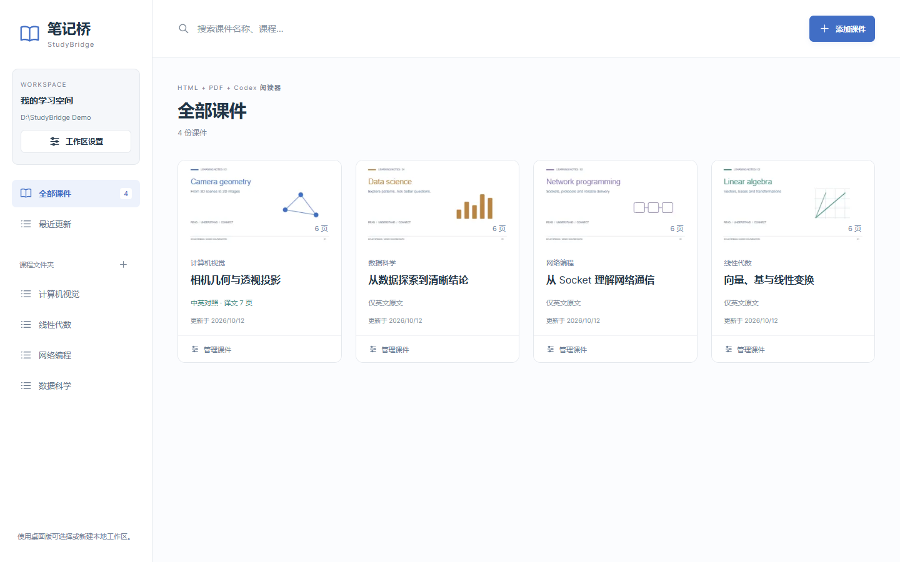
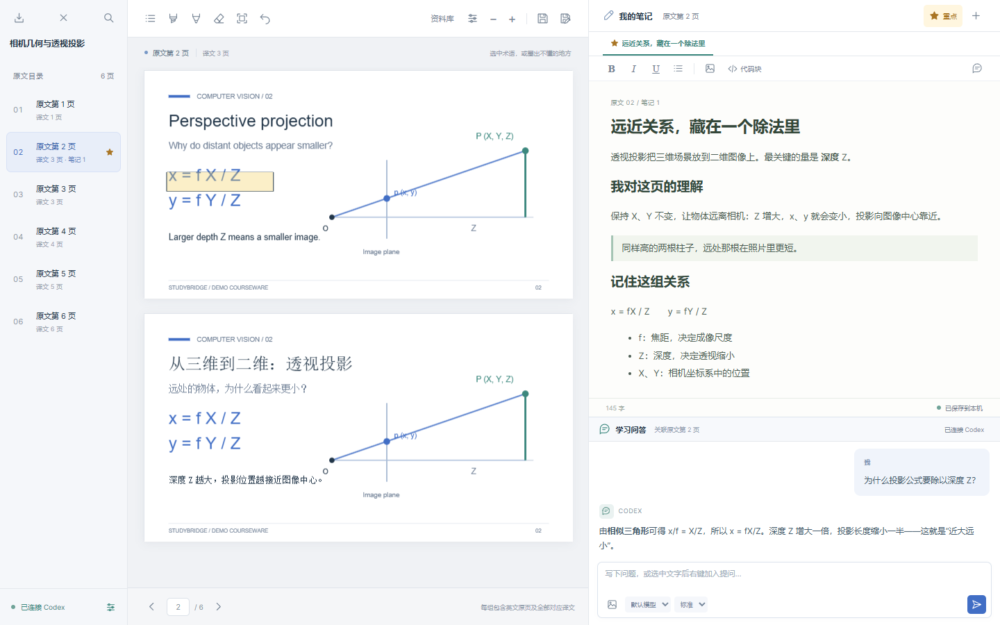

# StudyBridge · 笔记桥

**HTML + PDF + Codex 阅读器**

*概念插画，用于表达产品定位，并非软件界面截图。*

笔记桥（StudyBridge）是一个在本地运行的学习工作台。PDF 阅读区与笔记、问答面板并排，把英文原页、对应中文页、圈画和学习记录连在一起。笔记中的 HTML 演示组件帮助理解概念，Codex 则提供按页独立保存的问答。HTML 用于笔记演示，课件以 PDF 导入。

Read source and translated PDFs, keep notes with sandboxed HTML demos, and ask Codex in one local workspace.

**Windows 11 x64 · 本地文件存储 · 免费个人非商业学习使用**

**[下载笔记桥](https://github.com/YouXiangyu/studybridge/releases/latest) · [使用教程](https://github.com/YouXiangyu/studybridge/blob/main/docs/GETTING_STARTED.md) · [问题反馈](https://github.com/YouXiangyu/studybridge/issues)**

## 六件日常学习的小事

1. **整理学习资料**：选择或新建本地工作区，用课程文件夹、搜索和项目卡片管理课件，随时返回资料库。
2. **按原页连读中英课件**：一张英文原页可关联一页或多页中文译稿。手工校对对应关系，或让 AI 根据文字摘要提出候选，审核后再应用。
3. **圈画后快速回看**：用画笔、高亮、整笔橡皮擦和撤销整理重点；点击笔记正文里的标注链接，回到课件中的位置。文字层 PDF 也可全文搜索。
4. **写自己的分页笔记**：富文本、图片、数学公式、代码块与重点星标，自动保存并显示保存状态。
5. **带着上下文提问**：点击发送才提交问题和相应截图。回答按页独立保存，生成中可停止，普通回答由你决定是否加入笔记。
6. **把概念变成交互演示**：自包含 HTML 代码块可在沙箱中运行。选中代码块可让 AI 提交修改；原内容已有变化时保留候选，避免覆盖新的编辑。

## 看看实际界面

### 先从资料库开始

按课程整理学习项目，搜索需要的课件，再进入阅读器。工作区对应你选择的本地文件夹，课件和学习记录保存在本机。

### 回到同一张原页

英文原页与对应译文连读，圈画、笔记和问答保持同一页上下文，便于回看和继续学习。

*以上为使用合成演示数据的实际界面截图；示例文字不代表真实课程内容或模型效果。安装包不附带这些课件或个人学习记录。*

## 几分钟开始使用

1. 安装 **[Node.js 22 或更新版本](https://nodejs.org/en/download)**，在新终端运行 `node --version` 确认安装成功。
2. 从 **[最新版本](https://github.com/YouXiangyu/studybridge/releases/latest)** 下载 `StudyBridge.exe`，放到长期保存的位置并双击。首次运行选择或新建工作区，浏览器会打开资料库。
3. 点击“添加课件”，导入英文 PDF 和可选的中文 PDF。PPT/PPTX 请先导出为 PDF；没有译文也可以开始阅读和记录。
4. 需要 AI 时，安装并登录 **[Codex CLI](https://developers.openai.com/codex/cli/)**，再到笔记桥的“Codex 连接设置”检测连接并选择可用模型。使用自己的账号；已有 CLI 登录可继续使用。
5. 用完后选择文件菜单或系统托盘中的 **“保存并退出”**，等待各标签页完成保存。

EXE 是使用本机依赖的轻量启动程序，**不捆绑 Node、Codex 或浏览器**，也不需要 Python。首次启动会释放阅读器资源，以后复用缓存；阅读、圈画和笔记不需要 Codex。最终体积以同一 Release 的 `build-info.json` 为准。

安装与日常操作的完整说明见 [初始化与使用教程](https://github.com/YouXiangyu/studybridge/blob/main/docs/GETTING_STARTED.md)。下载后可核对同一 Release 提供的 SHA-256；当前版本尚未代码签名。

## 数据放在哪里

工作区位置由你选择，成功打开后会被记住。在资料库中可以新建或切换工作区；切换前等待所有打开的学习页完成保存。可从系统托盘选择“打开工作区”查看本地文件。

单个项目可导出为 `.study.json` 学习包，包含课件与学习记录；导入会创建新副本。备份整个工作区时，先正常退出，再复制工作区文件夹。更新程序也应先保存退出，保留原工作区后替换 EXE。

本地服务仅监听 `127.0.0.1`。阅读、圈画和笔记在本地完成；AI 需要网络和账号可用额度。点击发送时，问题、当前适用课件单页截图、当前笔记分页截图及手动附件会发送给模型。点击“AI 建议”时，发送两份 PDF 的页文字摘要用于对齐，不直接发送 PDF 文件本身。

请勿分享 Codex 登录目录或未经检查的学习包。更多说明见 [安全与隐私](https://github.com/YouXiangyu/studybridge/blob/main/SECURITY.md)。

## 当前边界

- 面向 Windows 11 x64，尚未提供其他系统或 ARM64 原生发布包。
- 搜索与页码匹配依赖 PDF 文字层，不包含 OCR 或自动课件翻译。
- 暂无云同步、多人协作、无限画布和自动更新。
- 关闭浏览器标签不会停止托盘服务，日常请使用“保存并退出”。
- AI 建议需要人工检查；可用模型、额度和服务可用性取决于自己的账号。

## 反馈与许可

遇到问题或有功能建议，欢迎 [提交 Issue](https://github.com/YouXiangyu/studybridge/issues)，说明版本、操作步骤与预期结果。请使用合成内容或脱敏样本，不上传私人课件、凭据和完整学习包。

笔记桥为**专有软件**，免费用于个人非商业学习；商业使用与再分发需取得另行书面授权。可分享官方发布页链接，引导他人下载。详见 [使用许可](https://github.com/YouXiangyu/studybridge/blob/main/LICENSE)；第三方组件保留各自许可证，见 [第三方声明](https://github.com/YouXiangyu/studybridge/blob/main/THIRD-PARTY-NOTICES.md)。本项目独立开发，与 OpenAI 无隶属关系。

[版本记录](https://github.com/YouXiangyu/studybridge/blob/main/CHANGELOG.md) · [验收记录](https://github.com/YouXiangyu/studybridge/blob/main/docs/RELEASE_VALIDATION.md) · [下载最新版本](https://github.com/YouXiangyu/studybridge/releases/latest)
